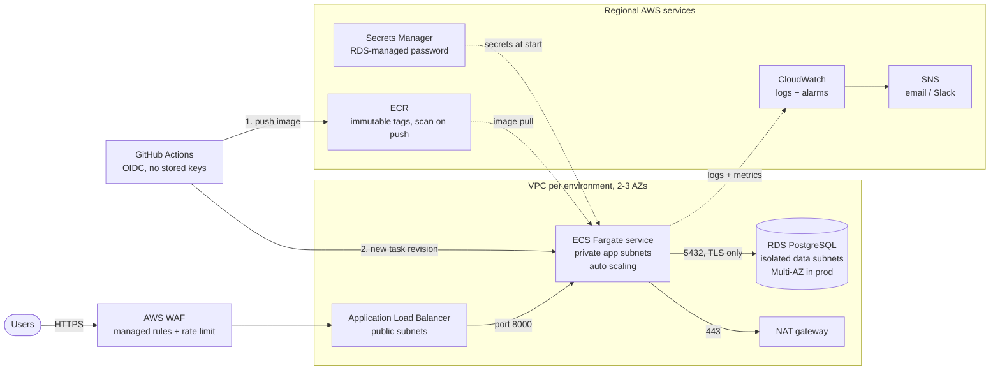

# Containerised web app on AWS ECS Fargate, with Terraform

[](https://github.com/muhammad-31/aws-ecs-fargate-terraform/actions/workflows/ci.yml)


[](LICENSE)

A reference implementation for one of the most common AWS requests: *"we have a
Dockerised app, put it on AWS properly"*. One `terraform apply` per environment
gives you a private-network ECS Fargate service behind an ALB with WAF, a
PostgreSQL database whose password nobody ever sees, alarms, and a GitHub
Actions pipeline that deploys without any stored AWS keys.

The included FastAPI service is a stand-in. Swap `app/` for your own image and
the infrastructure stays the same.

## Architecture



## What you get

| Area | Details |
|---|---|
| **Network** | VPC with public, private-app and isolated data subnets across 2-3 AZs. One NAT gateway in dev, one per AZ in prod. Free S3 gateway endpoint; ECR/Logs/Secrets Manager interface endpoints in prod. VPC flow logs. Default security group locked down. |
| **Edge** | ALB with HTTP to HTTPS redirect, TLS 1.3/1.2 policy, invalid-header dropping, access logs to S3. AWS WAF with Common and Known-Bad-Inputs rule sets plus a per-IP rate limit; WAF logs redact `Authorization` and cookies. |
| **Compute** | ECS Fargate service in private subnets. Read-only root filesystem, non-root user, deployment circuit breaker with automatic rollback, target-tracking scaling on CPU and requests per task. Fargate Spot in dev. Optional ECS Exec with encrypted, logged sessions. |
| **Data** | RDS PostgreSQL 17, encrypted with a customer-managed KMS key, `rds.force_ssl`, Enhanced Monitoring, IAM auth enabled, slow-query logging. The master password is generated and rotated by RDS in Secrets Manager; it never appears in Terraform state or CI logs. |
| **Observability** | Container Insights, structured JSON app logs, and CloudWatch alarms for ALB/app 5xx, unhealthy targets, p95 latency, task memory, database CPU and free storage, all routed to one SNS topic. |
| **Delivery** | GitHub Actions with OIDC roles per purpose (plan, apply, deploy). PRs get a `terraform plan` for dev and prod in the job summary. Merges apply dev, then prod after approval. App changes are built once, scanned, pushed to ECR and promoted dev to prod. |
| **Quality gates** | `terraform fmt`/`validate`, `terraform test` against a mocked AWS provider, TFLint with the AWS ruleset, Checkov (Terraform, workflows, Dockerfile), Hadolint, pytest and a Grype image scan on every PR. All third-party actions are pinned to commit SHAs and kept current by Dependabot. |

## Repository layout

```text
.
├── bootstrap/            # once per account: state bucket, ECR, GitHub OIDC roles
├── modules/
│   ├── network/          # VPC, subnets, NAT, endpoints, flow logs
│   ├── alb/              # load balancer, listeners, access logs, WAF
│   ├── ecs-service/      # cluster, task definition, service, IAM, auto scaling
│   ├── rds-postgres/     # database, parameter group, monitoring
│   └── alarms/           # SNS topic + CloudWatch alarms
├── stacks/web-app/       # wires the modules into one environment
├── environments/
│   ├── dev/              # cheap: 2 AZs, 1 NAT, Spot, no deletion protection
│   └── prod/             # resilient: 3 AZs, NAT per AZ, Multi-AZ DB, WAF, HTTPS
├── app/                  # sample FastAPI service, Dockerfile, tests
├── docs/decisions/       # architecture decision records
└── .github/workflows/    # ci.yml, terraform.yml, deploy.yml
```

Dev and prod call the same stack. They differ only in inputs, never in code.

## Getting started

Prerequisites: Terraform >= 1.10, AWS CLI v2, an AWS account and a fork of this repository.

**1. Bootstrap the account (once)**

```bash
cd bootstrap
terraform init
terraform apply -var 'github_repository=<your-user>/aws-ecs-fargate-terraform'
terraform output github_variables
```

**2. Configure GitHub**

- *Settings → Environments*: create `dev` and `prod`. In both, set
  *Deployment branches* to `main` only; the AWS roles trust the environment
  name, so this is what stops other branches from using them. Add required
  reviewers to `prod`.
- *Settings → Secrets and variables → Actions → Variables*: add every value from
  `github_variables`, plus `PROJECT=webapp`.

The Terraform and deploy workflows skip themselves until these variables exist,
so the repository stays green before any AWS account is connected.

**3. Create the dev environment**

Push to `main` (the Terraform workflow applies dev), or run it locally:

```bash
cd environments/dev
terraform init -backend-config="bucket=<TF_STATE_BUCKET>" -backend-config="region=us-east-1"
terraform apply
```

**4. Ship the application**

Push a change under `app/` or run the *Build and deploy* workflow. Until this
first deploy the service reports image pull errors; that is expected, since the
`bootstrap` tag in the initial task definition does not exist yet.

```bash
curl "$(terraform -chdir=environments/dev output -raw app_url)/readyz"
# {"status":"ok","database":"ok","latency_ms":2.1}
```

For prod, set `certificate_arn` in `environments/prod/terraform.tfvars` (an ACM
certificate for your domain). A `check` block warns on every plan until it is set.

## Approximate monthly cost

us-east-1 on-demand list prices, before traffic and data transfer. Check the
[AWS Pricing Calculator](https://calculator.aws/) for your region.

| Component | dev | prod |
|---|---|---|
| NAT gateways | 1 × ~$33 | 3 × ~$33 |
| Application Load Balancer | ~$16 + LCUs | ~$16 + LCUs |
| Fargate tasks | 1 × 0.25 vCPU / 0.5 GB ≈ $9 | 2 × 0.5 vCPU / 1 GB ≈ $36 |
| RDS PostgreSQL | t4g.micro single-AZ ≈ $14 | t4g.medium Multi-AZ ≈ $105 |
| Interface endpoints | none | 4 × 3 AZs ≈ $88 |
| WAF | off | ≈ $8 + requests |
| **Rough total** | **≈ $75/month** | **≈ $350-400/month** |

The biggest levers are NAT gateways and interface endpoints. Dev can be
destroyed outside working hours (`deletion_protection = false` there on purpose).

## Security notes

- No long-lived credentials: GitHub assumes IAM roles through OIDC, each trusted
  only for specific events. `plan` is limited to pull requests and `main`, can
  read state and may only write lock files. Each environment has its own apply
  role, assumable only from that GitHub environment; `deploy` works from `main`
  and the two environments.
- The apply roles use `AdministratorAccess`, because Terraform here manages IAM,
  KMS and networking. Two controls keep that in check: deployment branch rules
  and prod reviewers. Dev and prod still share one account in this example.
  For real isolation, put each environment in its own AWS account (AWS
  Organizations), or attach a scoped policy and a permissions boundary.
- The deploy role can push to one ECR repository, update services named
  `<project>-*` and pass only the two ECS roles.
- Tasks have no public IPs. The database subnets have no route to the internet,
  and the DB security group accepts connections only from the service's security group.
- Data at rest uses customer-managed KMS keys with rotation: state, images, RDS
  storage, the RDS master secret, and every log group (ECS, VPC flow logs, RDS
  exports). The exception is ALB access logs, which only support SSE-S3.
- Every Checkov finding that is accepted rather than fixed has an inline
  `#checkov:skip` with the reason next to the resource.

## Design decisions

- [0001: ECS Fargate instead of EKS](docs/decisions/0001-ecs-fargate-over-eks.md)
- [0002: S3-native state locking](docs/decisions/0002-s3-native-state-locking.md)
- [0003: Deploys run in the pipeline, not in `terraform apply`](docs/decisions/0003-deploys-outside-terraform.md)

## Running the checks locally

```bash
make help        # list targets
make ci          # fmt check, validate, terraform test, tflint, checkov, pytest
TF=tofu make ci  # same with OpenTofu
```

## Known limitations and next steps

- The sample app connects with the RDS master user. A real service should get
  its own database role with only the grants it needs.
- DNS and certificates (Route 53, ACM) are inputs, not managed here.
- Single region. Cross-region backups or a warm standby would be the next step
  for a stricter RTO/RPO.
- Rolling deployments only. Blue/green with CodeDeploy is a reasonable upgrade
  for services that need instant rollback.

## Tearing down

```bash
terraform -chdir=environments/dev destroy
# prod: set deletion_protection = false and apply first, then destroy
# bootstrap last: the state bucket has prevent_destroy, so remove that line first
```

## License

[MIT](LICENSE)
